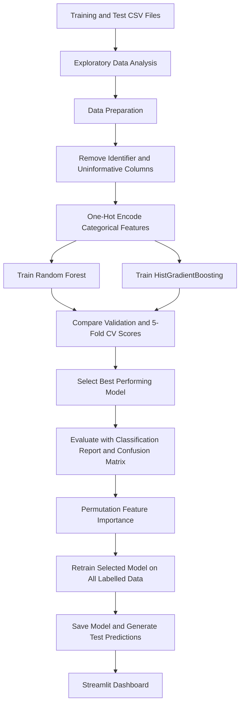

<div align="center">

# 📡 4G Network Congestion Prediction

### Machine Learning–Based Classification of Cellular Network Congestion

Predict the type of congestion in a cellular network cell using traffic, subscriber, timing, and radio access network (RAN) information.

<br>


</div>

---

## 📌 Overview

Network congestion can affect mobile network performance, reduce service quality, and create a poor user experience. Identifying the type of congestion helps network operators understand where a problem may be occurring and investigate it more efficiently.

This project uses **supervised machine learning** to classify cellular network observations into one of four congestion categories. It analyzes network-related information such as subscriber count, application traffic, time-related fields, cell configuration, and RAN vendor.

Two machine learning models are evaluated:

- **Random Forest Classifier**
- **HistGradientBoosting Classifier**

The better-performing model is selected using 5-fold cross-validation, trained on the complete labelled dataset, and used to generate predictions for the separate test dataset.

A **Streamlit dashboard** makes it possible to explore the dataset, review important features, and try the trained classifier interactively.

## 🎯 Project Objectives

- Analyze cellular network data to understand congestion patterns.
- Classify network observations into four congestion categories.
- Compare Random Forest and HistGradientBoosting models.
- Evaluate model performance using validation accuracy and 5-fold cross-validation.
- Identify influential input features using permutation importance.
- Generate predictions for an unlabelled test dataset.
- Present the analysis and predictions through an interactive dashboard.

## 🧠 Congestion Categories

The model predicts one of the following classes:

| Class | Description |
|---|---|
| `NC` | No congestion |
| `4G_RAN_CONGESTION` | Congestion in the 4G Radio Access Network (RAN) |
| `4G_BACKHAUL_CONGESTION` | Congestion in the 4G backhaul connection |
| `3G_BACKHAUL_CONGESTION` | Congestion in the 3G backhaul connection |

## 🛠️ Technology Stack

| Technology | Usage |
|---|---|
| Python | Main programming language |
| Pandas | Dataset loading and manipulation |
| NumPy | Numerical computing |
| Scikit-learn | Preprocessing, model training, and evaluation |
| Random Forest | Classification model |
| HistGradientBoosting | Classification model |
| Matplotlib & Seaborn | Exploratory data visualization in the notebook |
| Joblib | Saving and loading the trained model |
| Streamlit | Interactive web dashboard |
| Jupyter Notebook | Exploratory data analysis and model experimentation |

## 📂 Project Structure

```text
Network-Congestion-Prediction/
│
├── data/
│   ├── train_upd.csv
│   ├── test_upd.csv
│   └── DATASET_SUMMARY.txt
│
├── notebooks/
│   └── 4G_Network_Congestion_Analysis.ipynb
│
├── outputs/
│   ├── model.joblib
│   ├── congestion_predictions.csv
│   ├── feature_importance.csv
│   └── validation_report.txt
│
├── app.py
├── train_model.py
├── tests.py
├── requirements.txt
└── README.md
```

## 📊 Dataset Description

The project includes two CSV datasets:

| Dataset | Records | Columns | Description |
|---|---:|---:|---|
| `train_upd.csv` | 78,560 | 39 | Labelled data used for model training and evaluation |
| `test_upd.csv` | 26,305 | 38 | Unlabelled data used to generate predictions |

**Target column:** `Congestion_Type`  
**Identifier column:** `cell_name`

The training dataset contains four congestion classes with relatively balanced class distributions. The dataset summary reports no missing values in either dataset.

### Input Features

The input data includes:

- **Time information:** day, hour, and minute.
- **Subscriber information:** subscriber count.
- **Application traffic:** total bytes for web browsing, video, social networking, gaming, communication, file sharing, and other application categories.
- **Cell configuration:** beam direction, cell range, and tilt.
- **Network information:** RAN vendor.

The `cell_name` identifier and the columns `par_year`, `par_month`, and `4G_rat` are excluded from model training by the current implementation.

## ⚙️ Machine Learning Workflow



### 1. Data Preparation

- Load the labelled training dataset and unlabelled test dataset.
- Separate `Congestion_Type` as the target variable.
- Remove the cell identifier and selected uninformative columns.
- Identify categorical input columns.
- Apply `OneHotEncoder` to categorical features.
- Use a Scikit-learn pipeline to combine preprocessing and classification.

### 2. Model Training

Two classifiers are compared:

**Random Forest Classifier**

An ensemble learning algorithm that combines predictions from multiple decision trees to classify observations.

**HistGradientBoosting Classifier**

A gradient boosting algorithm that builds decision trees sequentially, improving the model by learning from previous prediction errors.

### 3. Model Evaluation

- Split the labelled dataset into 75% training data and 25% validation data.
- Use stratified sampling to preserve class proportions.
- Evaluate both models using validation accuracy.
- Apply 5-fold cross-validation to compare model performance.
- Generate a classification report and confusion matrix for the selected model.

### 4. Feature Importance

Permutation importance is used to understand which input features contribute most to model performance.

It works by shuffling one feature at a time and measuring the resulting decrease in model accuracy. A larger decrease indicates that the model relies more on that feature.

### 5. Final Prediction

After model selection, the selected classifier is retrained using all labelled training records. It then predicts the congestion category for each record in `test_upd.csv`.

The predictions and trained model are saved in the `outputs/` directory.

## 📈 Model Performance

The following results are taken from the project's generated `outputs/validation_report.txt`.

| Model | Validation Accuracy | 5-Fold CV Accuracy |
|---|---:|---:|
| Random Forest | 74.41% | 74.30% |
| **HistGradientBoosting** | **79.70%** | **79.32%** |

**Selected model:** HistGradientBoosting Classifier

The selected model performs approximately 5 percentage points better than Random Forest in both validation and cross-validation accuracy.

### Classification Report

The selected model achieved the following class-wise results on the 25% validation split:

| Congestion Class | Precision | Recall | F1-Score |
|---|---:|---:|---:|
| 3G Backhaul | 0.77 | 0.79 | 0.78 |
| 4G Backhaul | 0.70 | 0.70 | 0.70 |
| 4G RAN | 0.83 | 0.79 | 0.81 |
| No Congestion (NC) | 0.89 | 0.90 | 0.90 |
| **Overall Accuracy** | | | **0.80** |

**Observation:** The model performs best at identifying `NC`. Distinguishing between 4G backhaul and 4G RAN congestion is more challenging and remains an area for improvement.

> **Evaluation note:** The test dataset does not contain ground-truth congestion labels. Therefore, the reported accuracy values come from the labelled training dataset's validation and cross-validation experiments; they are not test-set accuracy.

## ⭐ Key Features

### 📊 Data Exploration
- View the number of observations, input columns, and congestion categories.
- Explore the distribution of congestion types.
- Compare records by RAN vendor.
- Inspect application traffic statistics.
- Filter and browse dataset records.

### ⭐ Important Feature Analysis
- View the top 15 features ranked by permutation importance.
- Understand how individual input features affect model accuracy.

### 🤖 Interactive Prediction
- Select a congestion category to choose an example from the dataset.
- Modify the five most important input values.
- Get a predicted congestion category.
- View the model's class probability scores.
- Compare the prediction with the example's known label.

**Note:** The dashboard's interactive examples are sampled from the training dataset. They are useful for demonstrating the model, but they are not independent real-world test cases.

## 🚀 Getting Started

### Prerequisites

- Python 3.10 or later
- pip
- Git

### 1. Clone the Repository

```bash
git clone https://github.com/Pooja-malipatil/Network-Congestion-Prediction.git
```

### 2. Navigate to the Project Directory

```bash
cd Network-Congestion-Prediction
```

### 3. Create a Virtual Environment

**Windows:**

```bash
python -m venv .venv
.venv\Scripts\activate
```

**macOS / Linux:**

```bash
python3 -m venv .venv
source .venv/bin/activate
```

### 4. Install Dependencies

```bash
python -m pip install --upgrade pip
pip install -r requirements.txt
```

### 5. Train and Evaluate the Models

```bash
python train_model.py
```

This command:

- Loads the training and test datasets.
- Trains and compares both classifiers.
- Selects the best model using 5-fold cross-validation.
- Generates the validation report.
- Calculates permutation feature importance.
- Saves the final trained model.
- Generates predictions for the test dataset.

### 6. Launch the Dashboard

```bash
streamlit run app.py
```

The Streamlit dashboard will open in your browser.

### 7. Run the Tests

After generating the model and prediction files, execute:

```bash
python tests.py
```

The test script checks dataset loading, predictions across all four classes, missing-file handling, model saving, prediction output, and dashboard execution.

## 📁 Generated Outputs

Running `train_model.py` generates the following files:

| Output | Description |
|---|---|
| `model.joblib` | Saved trained machine learning pipeline |
| `congestion_predictions.csv` | Predicted congestion labels for test records |
| `feature_importance.csv` | Permutation importance scores for input features |
| `validation_report.txt` | Model comparison and classification evaluation results |

## 🔮 Future Improvements

- Improve classification between 4G RAN and 4G backhaul congestion.
- Perform hyperparameter tuning to improve model performance.
- Explore additional network performance metrics and historical observations.
- Evaluate the model on independently labelled, unseen network data.
- Add model monitoring and prediction history to the dashboard.
- Explore explainability techniques for individual predictions.

## 👩‍💻 Author

**Pooja Malipatil**

- GitHub: [@Pooja-malipatil](https://github.com/Pooja-malipatil)
- Project Repository: [Network Congestion Prediction](https://github.com/Pooja-malipatil/Network-Congestion-Prediction)

---

<div align="center">

**Built with Python, Scikit-learn, and Streamlit.**

</div>
